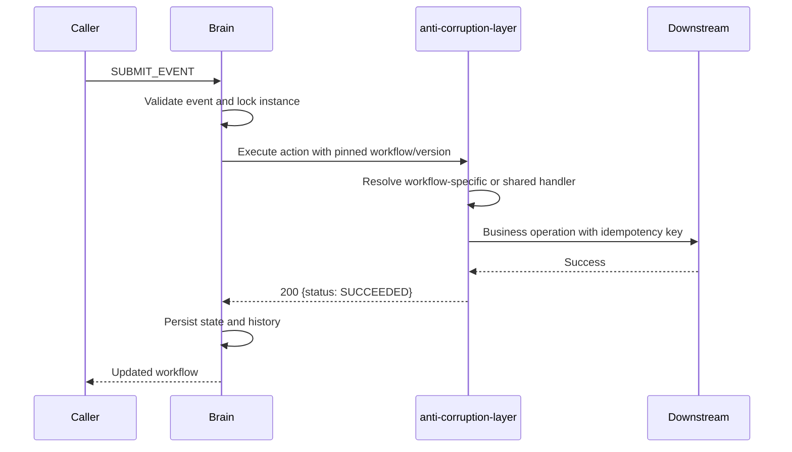

# Configurable workflow steps



The database controls states, transitions and their action bindings. Different
workflow definitions can use different numbers of states, reuse state names and
reuse action names without sharing their implementations. Instances stay pinned
to a definition version.

Local bookkeeping names (`recordStateEntry`, `recordStateExit`, `observeState`,
`recordTransition`) are reserved. Every other action name delegates to the ACL.
Business actions should be bound to transitions, not entry/exit/activity hooks,
so restoring or starting a machine never triggers a business operation.

Implement `WorkflowStepHandler` in the ACL with `@Component`; Spring discovers it
automatically. Only implementation routing metadata belongs here; state order
stays in the brain database:

```java
@Component
class LoanOtpHandler implements WorkflowStepHandler {
    public String workflowKey() { return "loan"; }
    public int definitionVersion() { return 2; }
    public String actionName() { return "verifyOtp"; }
    public void execute(StepInvocation invocation) {
        // Call the OTP provider, using invocation.referenceId() to locate inputs.
        // Deduplicate remote mutations with invocation.idempotencyKey().
        // Throw if verification fails or its outcome is uncertain.
    }
}
```

Use workflow key `*` for a shared implementation and version `0` (the default)
for all versions. Resolution order is workflow/exact version, workflow/all
versions, shared/exact version, then shared/all versions. Duplicate registration
keys fail startup. An unknown action fails execution; no fallback reports success.
A handler never chooses the next state or changes the brain database.

Publish graph changes in a new Flyway migration as a new definition version.
Deploy compatible ACL handlers before activating that version. No brain Java
change is needed for new business action names. Existing instances retain their
original graph and must retain compatible ACL implementations.

All actions complete before the brain commits state/history. HTTP errors,
timeouts and invalid acknowledgements abort the workflow transaction. Remote side
effects cannot be rolled back by JDBC. The brain forwards the original idempotency
key and performs no application-level HTTP retries. Each real ACL integration must
durably deduplicate its downstream operation (including after a timeout or a brain
rollback). When a transition invokes multiple business actions, scope downstream
deduplication by workflow/version/reference/action and the caller idempotency key.
The ACL scaffolding has no business effects or durable result store yet; do not
add real side effects without implementing this guarantee.

## Finaag and Lyntra

`finaag` is the default workflow; `lyntra` must be selected on CREATE. Workflow
keys and event codes are case sensitive.

| Workflow | Command sequence | States |
| --- | --- | --- |
| `finaag` | `VERIFY_OTP` → `UPDATE_PROFILE` → `UPLOAD_ACCOUNT_STATEMENT` → `UPLOAD_UDYAM_DOCUMENT` | 5 |
| `lyntra` | `VERIFY_OTP` → `VERIFY_IDENTITY` → `SELECT_PLAN` | 4 |

Finaag retains the original sequence. Lyntra follows:

```text
OTP_VERIFICATION --VERIFY_OTP--> IDENTITY_REVIEW
IDENTITY_REVIEW --VERIFY_IDENTITY--> PLAN_SELECTION
PLAN_SELECTION --SELECT_PLAN--> COMPLETED
```

The brain owns these sequences and sends the workflow key/version and action name
to the ACL. Individual `@Component` implementations in `strategy/step` execute the
action; there are no ACL workflow lists or grouped registration classes.
Both workflows use `VerifyOtpStep`. The other actions have implementations scoped
to their workflow key. All six implementations log local completion and succeed by
default. Replace each `execute` body with its downstream API call later; no demo flag
is required. These local defaults do not perform real business operations yet.

Create a Lyntra instance with:

```json
{
  "metadata": {
    "operation": "CREATE",
    "requestId": "req-lyntra",
    "referenceId": "LYN-101",
    "workflowKey": "lyntra",
    "idempotencyKey": "LYN-101-create"
  },
  "payload": {}
}
```

Submit the commands in the table in order, each with its own idempotency key.
SUBMIT_EVENT uses the instance reference to find the workflow; omit `workflowKey`
on that operation. Event names determine business actions, not state ordering.
